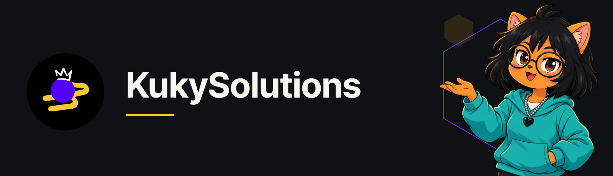
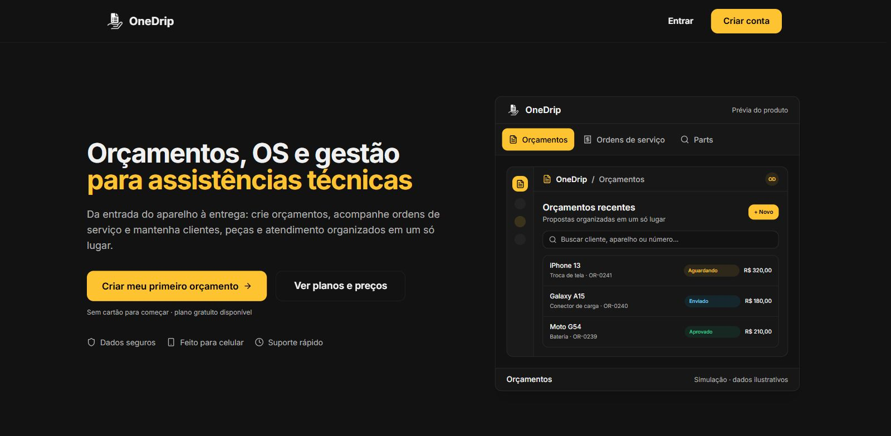
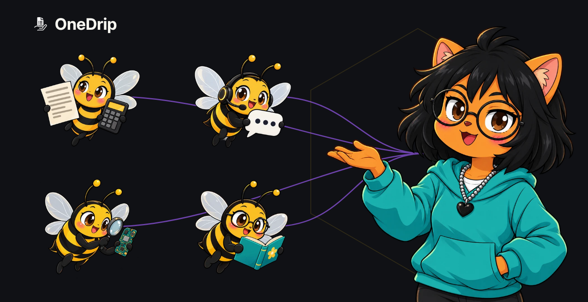
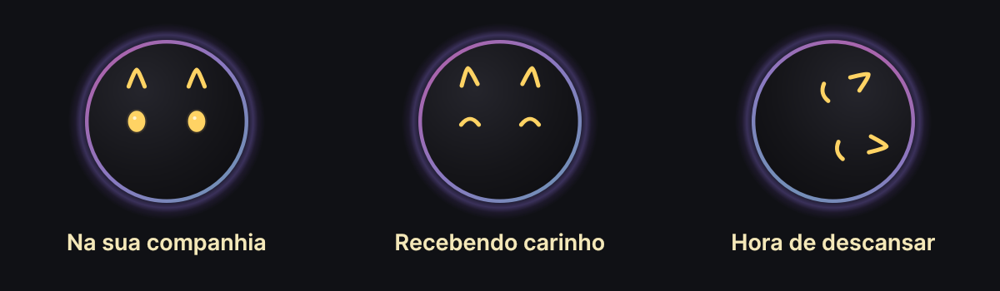

# KukySolutions

**Software útil. Projetos com personalidade.**

Desenvolvo o **OneDrip**, a assistente **Drippy** e a **Bolha**, um pet experimental para o desktop.

[OneDrip](#onedrip) · [Drippy e a colmeia](#drippy-e-a-colmeia) · [Bolha](#bolha) · [Tecnologias](#tecnologias)

## OneDrip

Gestão para assistências técnicas de celulares e eletrônicos: orçamentos, ordens de serviço, clientes, peças e atendimento em um só lugar.

[Conhecer o OneDrip](https://onedrip.com.br) · [Conhecer o OneDrip Parts](https://onedrip.com.br/parts)

*Demonstração pública com dados fictícios.*

## Drippy e a colmeia

A **Drippy é a assistente de IA do OneDrip**. Sua colmeia reúne especialistas para apoiar orçamentos, atendimento, pesquisa de peças e o uso do sistema.

Você confere os resultados e decide o que fazer. Na pesquisa de peças, consulte as fontes e verifique a compatibilidade.

[Conhecer a Drippy e a colmeia](https://onedrip.com.br/drippy)

## Bolha

Um pet experimental para Windows que passeia pela tela, reage ao carinho, brinca e aprende com suas interações.

**Versão publicada: 0.3.0**, nativa em Python e Qt/PySide6.

*Prévia vetorial da Bolha 0.3.0 em Qt.*

[Ver versões e download](https://github.com/kuky13/bolha/releases/latest) · [Explorar o código público](https://github.com/kuky13/bolha)

### Créditos da Bolha

O motor da Bolha deriva do [Pestinha](https://github.com/mille-okws/pestinha), criado pelo [autor original](https://github.com/mille-okws) e seus contribuidores. Consulte a [autoria e as licenças da Bolha](https://github.com/kuky13/bolha/blob/main/NOTICE.md).

## Tecnologias

| Área | Tecnologias e uso |
|---|---|
| Interface do OneDrip | TypeScript, React, Vite, Tailwind CSS e Radix UI |
| Dados e backend | Supabase, PostgreSQL e funções em Deno/TypeScript |
| Estado e consultas | TanStack Query e Zustand |
| Integrações | IA, WhatsApp e diagnóstico Android com ADB/WebUSB |
| Qualidade | Vitest, Playwright e ESLint |
| Bolha nativa | Python, Qt/PySide6 e PyInstaller |

[Origem e atribuição das imagens](assets/README.md)

*Versões conferidas em 3 de novembro de 2026.*
