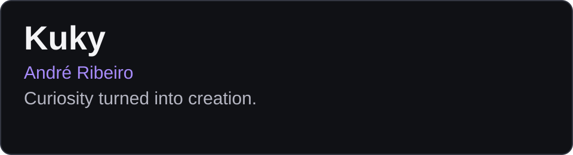
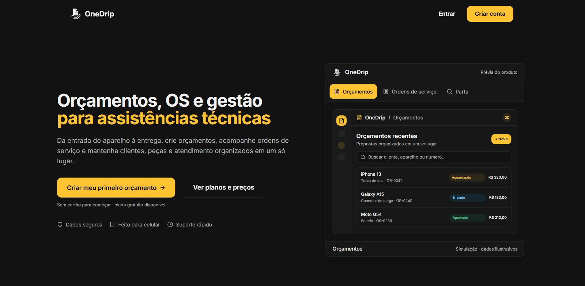

# Kuky

André Ribeiro

**Filmmaker, video editor, software developer, and phone repair technician.**

I explore ideas, tell stories, and build solutions, from the workbench to the screen. Three years at Oliveira Imports and more than 1,300 phones repaired shape the way I approach both creative work and software.

[Portfolio](https://kuky.solutions) · [WhatsApp](https://wa.me/556499489175)

## What I do

- **Video editing:** I edit videos, working on cuts, pacing, captions and sound.
- **Code:** I build interfaces and tools with React, TypeScript, Supabase and PostgreSQL.
- **Repair:** Three years diagnosing and repairing phones at [Oliveira Imports](https://www.instagram.com/oliveira_importsgo/), with **1,300+ phones repaired**.

## Projects

### OneDrip

I develop **OneDrip**, software for phone and electronics repair shops. It brings quotes, service orders, clients, parts research and customer service into one place.

[Explore OneDrip](https://onedrip.com.br) · [Parts research](https://onedrip.com.br/parts)

*Public demonstration with sample data.*

### Drippy and the hive

**Drippy is OneDrip’s AI assistant.** Her hive supports quotes, customer service, parts research and help with the system. You review the results and decide what to do; check sources and compatibility when researching parts.

[Meet Drippy](https://onedrip.com.br/drippy)

### Bolha

A community mascot for Windows and Android. Bolha wanders across the screen, plays and reacts to pats, surprises and other interactions, with original art and animations.

*Historical artwork from version 0.5.0. Use the latest-release link for current downloads.*

[Latest stable release](https://github.com/kuky13/bolha/releases/latest) · [Source code](https://github.com/kuky13/bolha)

## Tools I work with

| Area | Tools and use |
|---|---|
| Interfaces | React, TypeScript, Vite, Tailwind CSS, Radix UI |
| Data and backend | Supabase, PostgreSQL, Deno/TypeScript functions |
| Queries and state | TanStack Query, Zustand |
| Integrations | AI, WhatsApp, Android diagnostics with ADB/WebUSB |
| Quality | Vitest, Playwright, ESLint |
| Bolha | Python, NumPy, Qt/PySide6 on Windows; Java, Canvas, Chaquopy on Android |

## Let’s talk

[WhatsApp](https://wa.me/556499489175) · [Instagram @kuky.pv](https://www.instagram.com/kuky.pv/) · [YouTube @filosofunfando](https://www.youtube.com/@filosofunfando) · **Discord: `kuky.png`**

*Made between timelines, lines of code, and workbenches.*
