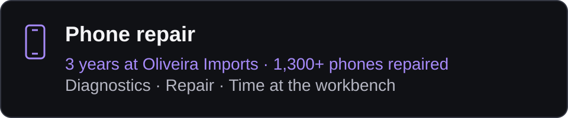
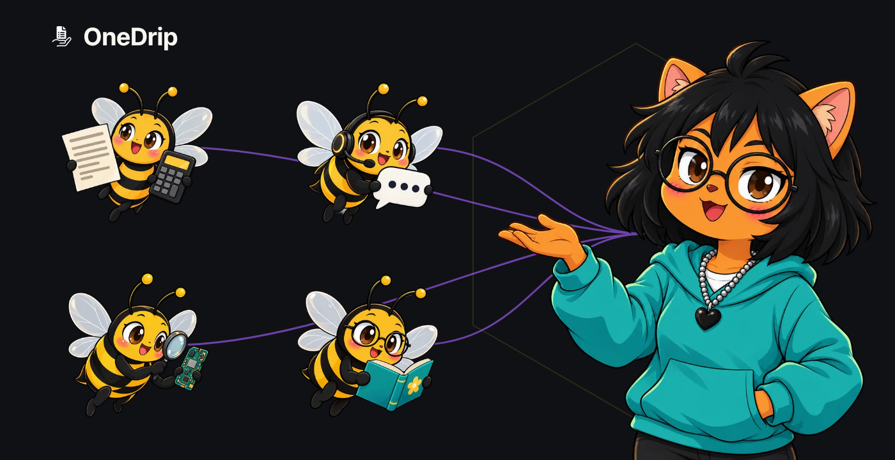

# kuky

André Ribeiro

**Filmmaker, video editor, software developer, and phone repair technician.**

I explore ideas, tell stories, and build solutions, from the workbench to the screen. Three years at Oliveira Imports and more than 1,300 phones repaired shape the way I approach both creative work and software.

[Portfolio](https://kuky.solutions) · [WhatsApp](https://wa.me/556499489175)

## What I do

- **Video editing:** I edit videos, working on cuts, pacing, captions and sound.
- **Code:** I build interfaces and tools with React, TypeScript, Supabase and PostgreSQL.
- **Repair:** Three years diagnosing and repairing phones at [Oliveira Imports](https://www.instagram.com/oliveira_importsgo/), with **1,300+ phones repaired**.

## Projects

### OneDrip

I develop **OneDrip**, software for phone and electronics repair shops. It brings quotes, service orders, clients, parts research and customer service into one place.

[Explore OneDrip](https://onedrip.com.br) · [Parts research](https://onedrip.com.br/parts)

*Public demonstration with sample data.*

### Drippy and the hive

**Drippy is OneDrip’s AI assistant.** Her hive supports quotes, customer service, parts research and help with the system. You review the results and decide what to do; check sources and compatibility when researching parts.

[Meet Drippy](https://onedrip.com.br/drippy)

### Bolha

A community mascot for Windows and Android. Bolha wanders across the screen, plays and learns locally from your interactions.

**Preview of version 0.5.4:** gradual anger, gentler pointer chewing on the PC, clearer speech and thought bubbles, and a revolution with a sign and bouncing toys. The settings include individual activity controls and 18 guided tests that preserve your mascot’s saved memory.

<picture>
  <source media="(prefers-reduced-motion: reduce)" srcset="assets/bolha-054-still.png">
  
</picture>

[View the still scenes](assets/bolha-054-still.png) · [Open the animation](assets/bolha-054-animation.gif)

*Directed scenes rendered by the real Qt application on Linux, with the interface in Portuguese. These images show the desktop renderer; they are not Android or Windows device recordings.*

Bolha is an open source fork of [Pestinha](https://github.com/mille-okws/pestinha), created by [mille-okws](https://github.com/mille-okws) and contributors. Bolha’s code, original artwork and animations are available under **GNU GPL version 3 or later**. [Credits and licenses](https://github.com/kuky13/bolha/blob/main/NOTICE.md). Community contributions are welcome.

[Windows installer 0.5.4](https://github.com/kuky13/bolha/releases/download/v0.5.4/Bolha-Setup-0.5.4-x64.exe) · [Android APK 0.5.4](https://github.com/kuky13/bolha/releases/download/v0.5.4/Bolha-0.5.4-Android.apk) · [Latest stable release](https://github.com/kuky13/bolha/releases/latest) · [Source code](https://github.com/kuky13/bolha)

## Tools I work with

| Area | Tools and use |
|---|---|
| Interfaces | React, TypeScript, Vite, Tailwind CSS, Radix UI |
| Data and backend | Supabase, PostgreSQL, Deno/TypeScript functions |
| Queries and state | TanStack Query, Zustand |
| Integrations | AI, WhatsApp, Android diagnostics with ADB/WebUSB |
| Quality | Vitest, Playwright, ESLint |
| Bolha | Python, NumPy, Qt/PySide6 on Windows; Java, Canvas, Chaquopy on Android |

## Let’s talk

[WhatsApp](https://wa.me/556499489175) · [Instagram @kuky.pv](https://www.instagram.com/kuky.pv/) · [YouTube @filosofunfando](https://www.youtube.com/@filosofunfando) · **Discord: `kuky.png`**

*Made between timelines, lines of code, and workbenches.*
