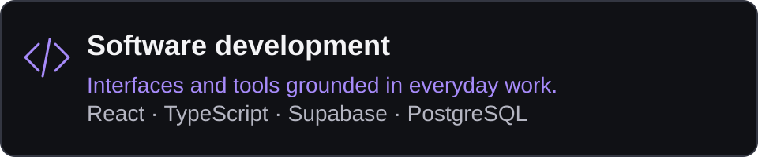

# André Ribeiro Lima · Kuky Solutions

**Filmmaker, video editor, software developer, and phone repair technician.**

I explore ideas, tell stories, and build solutions, from the workbench to the screen. Three years at Oliveira Imports and more than 1,300 phones repaired shape the way I approach both creative work and software.

[Portfolio](https://kuky.solutions) · [Português](README.pt-BR.md) · [Static cards](cards/static/)

## What I do

- **Film:** I shoot and edit video essays, motion, ads and short-form work. [Watch selected edits](https://kuky.solutions/#videos).
- **Code:** I build interfaces and tools with React, TypeScript, Supabase and PostgreSQL.
- **Repair:** Three years diagnosing and repairing phones at [Oliveira Imports](https://www.instagram.com/oliveira_importsgo/), with **1,300+ phones repaired**.

## Projects

### OneDrip

I develop **OneDrip**, software for phone and electronics repair shops. It brings quotes, service orders, clients, parts research and customer service into one place.

[Explore OneDrip](https://onedrip.com.br) · [Parts research](https://onedrip.com.br/parts)

*Public demonstration with sample data.*

### Drippy and the hive

**Drippy is OneDrip’s AI assistant.** Her hive supports quotes, customer service, parts research and help with the system. You review the results and decide what to do; check sources and compatibility when researching parts.

[Meet Drippy](https://onedrip.com.br/drippy)

### Bolha

A community desktop and Android mascot based on [Pestinha](https://github.com/mille-okws/pestinha). Bolha wanders across the screen, plays and reacts to pats, surprises and other interactions, with original art and animations.

*Historical artwork from version 0.5.0. Use the latest-release link for current downloads.*

[Latest stable release](https://github.com/kuky13/bolha/releases/latest) · [Source code](https://github.com/kuky13/bolha)

## Tools I work with

| Area | Tools and use |
|---|---|
| Interfaces | React, TypeScript, Vite, Tailwind CSS, Radix UI |
| Data and backend | Supabase, PostgreSQL, Deno/TypeScript functions |
| Queries and state | TanStack Query, Zustand |
| Integrations | AI, WhatsApp, Android diagnostics with ADB/WebUSB |
| Quality | Vitest, Playwright, ESLint |
| Bolha | Python, NumPy, Qt/PySide6 on Windows; Java, Canvas, Chaquopy on Android |

## Let’s talk

[WhatsApp](https://wa.me/556499489175) · [Instagram @kuky.pv](https://www.instagram.com/kuky.pv/) · [YouTube @filosofunfando](https://www.youtube.com/@filosofunfando) · **Discord: `kuky.png`**

## Credits and image provenance

Bolha is a community fork of **Pestinha**, created by [mille-okws](https://github.com/mille-okws) with community contributions. Pestinha’s brain, physics and parts of its app provided the foundation. Bolha’s code, original art and animations use **GPL version 3 or later**. [Credits and licenses](https://github.com/kuky13/bolha/blob/main/NOTICE.md).

OneDrip, Drippy, the hive illustrations and my avatar have separate rights; displaying them here does not grant a general reuse license. Private Drippy reference guides are not included. [Asset provenance](assets/README.md).

The authored SVGs follow the portfolio’s dark and violet identity. They contain a short entry animation, respect reduced motion, and have [static alternatives](cards/static/). No tracking, live statistics or scheduled jobs. Inspired by [Aviva Shishta’s article on animated SVG profile cards](https://www.avivashishta.com/blog/github-profile-readme-animated-svg-cards). Render with `python3 scripts/render-cards.py`; use `STATIC=1` for still images.

*Made between timelines, lines of code, and workbenches.*
