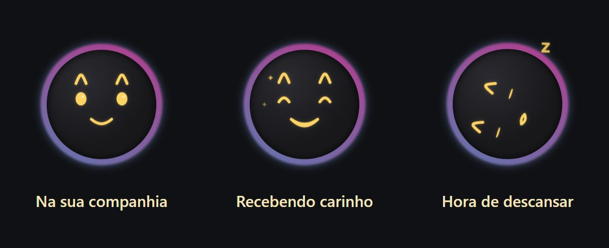

# KukySolutions

**Software útil. Projetos com personalidade.**

Crio aplicações para organizar o trabalho e projetos que tornam
o computador um lugar mais interessante.

[Conheça a Bolha](https://github.com/kuky13/bolha) ·
[Visite o OneDrip](https://onedrip.com.br)

## OneDrip — da entrada do aparelho à entrega

Uma plataforma para assistências técnicas de celulares e eletrônicos:
orçamentos, ordens de serviço, clientes, peças e atendimento
organizados em um só lugar.

*Captura da apresentação pública do OneDrip. Simulação com dados fictícios.*

O produto é desenvolvido em repositórios privados.

[Conhecer o OneDrip](https://onedrip.com.br) ·
[Explorar o OneDrip Parts](https://onedrip.com.br/parts)

## Bolha — companhia para o seu desktop

Um pet experimental para Windows que passeia pela tela, reage
ao carinho, brinca e aprende com suas interações.

*Prévia renderizada a partir do código da versão 0.2.1,
[commit 8d67085](https://github.com/kuky13/bolha/commit/8d6708574ebe636b9ecce58e50dc89342a7ea4a4).
O link de download aponta para a versão publicada mais recente.*

Interface em Electron e React, com comportamento e memória locais
em Python.

[Explorar o código](https://github.com/kuky13/bolha) ·
[Ver versões e download](https://github.com/kuky13/bolha/releases/latest)

## Uma base que merece crédito

A Bolha utiliza uma adaptação do motor do Pestinha, criado por
mille-okws e seus contribuidores. A origem e as licenças estão
documentadas no projeto.

[Conhecer o Pestinha](https://github.com/mille-okws/pestinha) ·
[Consultar os créditos da Bolha](https://github.com/kuky13/bolha/blob/main/NOTICE.md)

## Tecnologias dos projetos

TypeScript · React · Electron · Python · Flutter · Supabase

[Origem e atribuição das imagens](assets/README.md)
