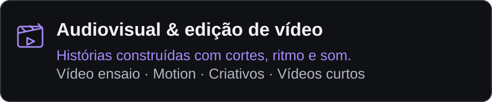
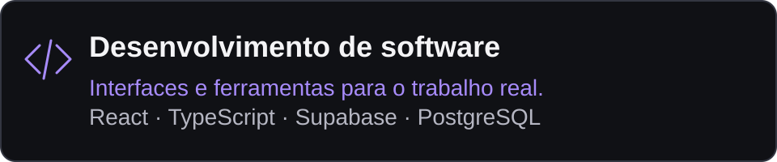
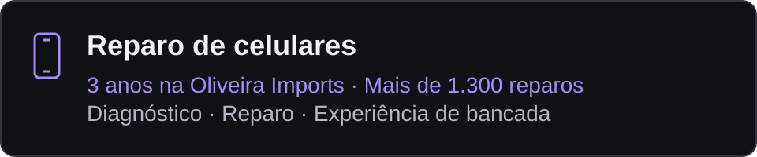
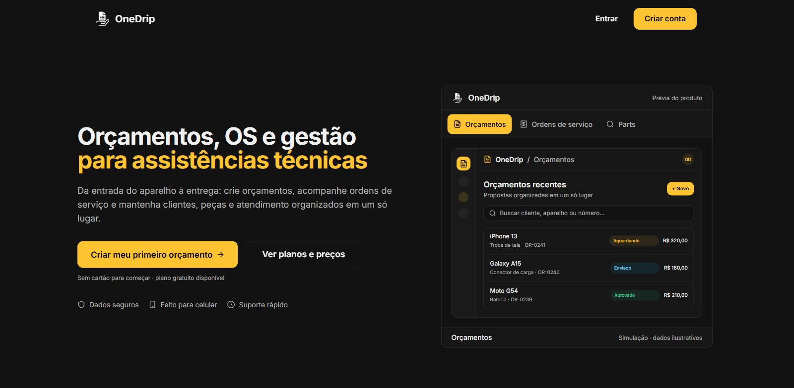
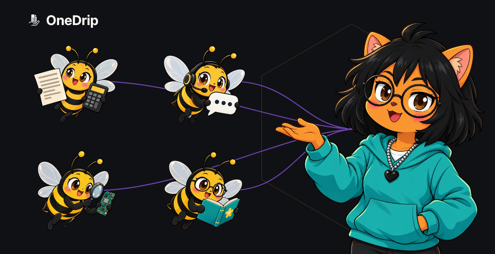
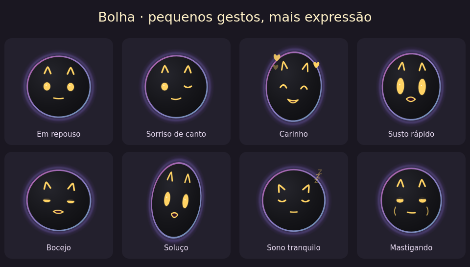

# André Ribeiro Lima · Kuky Solutions

**Filmmaker, editor de vídeo, desenvolvedor e técnico de celulares.**

Exploro ideias, crio histórias e desenvolvo soluções, da bancada à tela. Três anos na Oliveira Imports e mais de 1.300 celulares reparados ajudam a definir como penso meus trabalhos e meu software.

[Portfólio](https://kuky.solutions/?lang=pt) · [English](README.md) · [Cartões estáticos](cards/static/)

## O que eu faço

- **Audiovisual:** filmo e edito vídeo ensaio, motion, criativos e vídeos curtos. [Veja meus trabalhos](https://kuky.solutions/?lang=pt#videos).
- **Código:** construo interfaces e ferramentas com React, TypeScript, Supabase e PostgreSQL.
- **Reparos:** três anos diagnosticando e reparando celulares na [Oliveira Imports](https://www.instagram.com/oliveira_importsgo/), com **mais de 1.300 celulares reparados**.

## Projetos

### OneDrip

Desenvolvo a **OneDrip**, um sistema para assistências técnicas de celulares e eletrônicos. Orçamentos, ordens de serviço, clientes, pesquisa de peças e atendimento num só lugar.

[Conheça a OneDrip](https://onedrip.com.br) · [Pesquisa de peças](https://onedrip.com.br/parts)

*Demonstração pública com dados fictícios.*

### Drippy e a colmeia

**A Drippy é a assistente de IA da OneDrip.** Sua colmeia apoia orçamentos, atendimento, pesquisa de peças e o uso do sistema. Você confere os resultados e decide o que fazer. Na pesquisa de peças, consulte as fontes e verifique a compatibilidade.

[Conheça a Drippy](https://onedrip.com.br/drippy)

### Bolha

Uma mascote comunitária para Windows e Android baseada no [Pestinha](https://github.com/mille-okws/pestinha). Passeia pela tela, brinca e reage a carinho, susto e outras interações, com arte e animações próprias.

*Arte histórica da versão 0.5.0. O link da última versão sempre aponta para os downloads atuais.*

[Última versão estável](https://github.com/kuky13/bolha/releases/latest) · [Código-fonte](https://github.com/kuky13/bolha)

## Ferramentas que utilizo

| Área | Tecnologias e uso |
|---|---|
| Interface | React, TypeScript, Vite, Tailwind CSS e Radix UI |
| Dados e backend | Supabase, PostgreSQL e funções em Deno/TypeScript |
| Consultas e estado | TanStack Query e Zustand |
| Integrações | IA, WhatsApp e diagnóstico Android com ADB/WebUSB |
| Qualidade | Vitest, Playwright e ESLint |
| Bolha | Python, NumPy e Qt/PySide6 no Windows; Java, Canvas e Chaquopy no Android |

## Vamos conversar?

[WhatsApp](https://wa.me/556499489175) · [Instagram @kuky.pv](https://www.instagram.com/kuky.pv/) · [YouTube @filosofunfando](https://www.youtube.com/@filosofunfando) · **Discord: `kuky.png`**

## Créditos e imagens

A Bolha é um fork comunitário do **Pestinha**, criado por [mille-okws](https://github.com/mille-okws) com a colaboração da comunidade. O cérebro, a física e partes da aplicação do Pestinha foram sua base. O código, as artes e as animações próprias da Bolha são abertos sob **GPL versão 3 ou posterior**. [Créditos e licenças](https://github.com/kuky13/bolha/blob/main/NOTICE.md).

A OneDrip, a Drippy, as ilustrações da colmeia e meu avatar têm direitos separados. Sua publicação não concede licença geral de reutilização. Os guias privados da Drippy não estão incluídos. [Origem das imagens](assets/README.md).

Os SVGs seguem a identidade escura e violeta do portfólio, com uma entrada curta, respeito à preferência de movimento reduzido e [alternativas estáticas](cards/static/). Sem rastreamento, estatísticas ao vivo ou tarefas agendadas. Inspirados no [artigo de Aviva Shishta sobre cartões SVG animados](https://www.avivashishta.com/blog/github-profile-readme-animated-svg-cards). Gere com `python3 scripts/render-cards.py`; use `STATIC=1` para imagens estáticas.

*Feito entre timelines, linhas de código e bancadas.*
